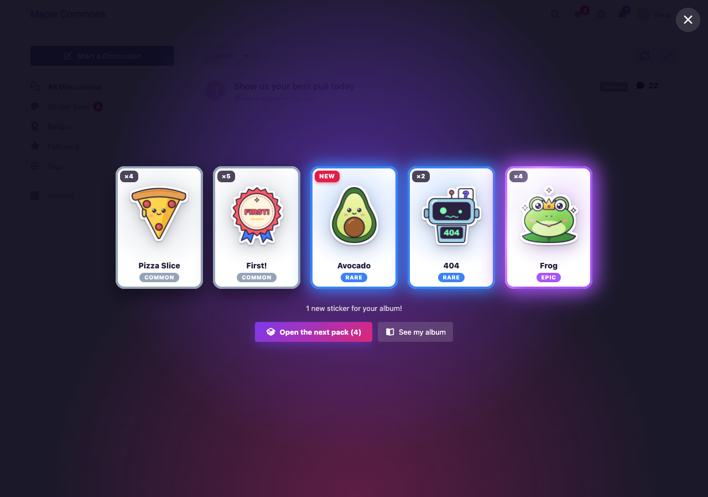
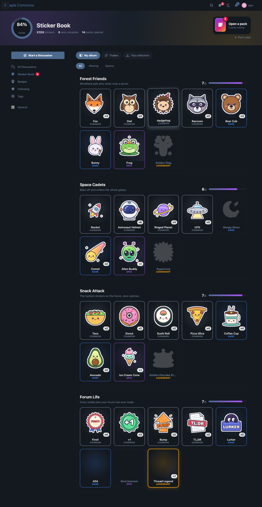
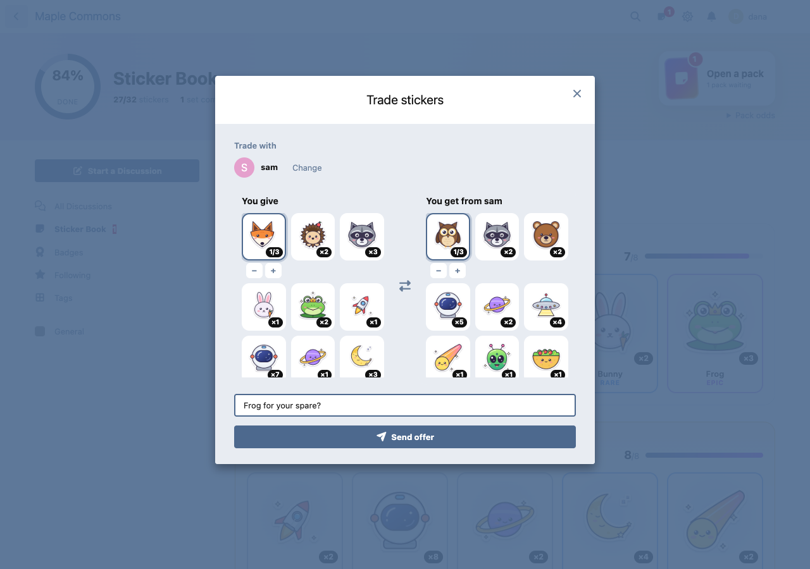
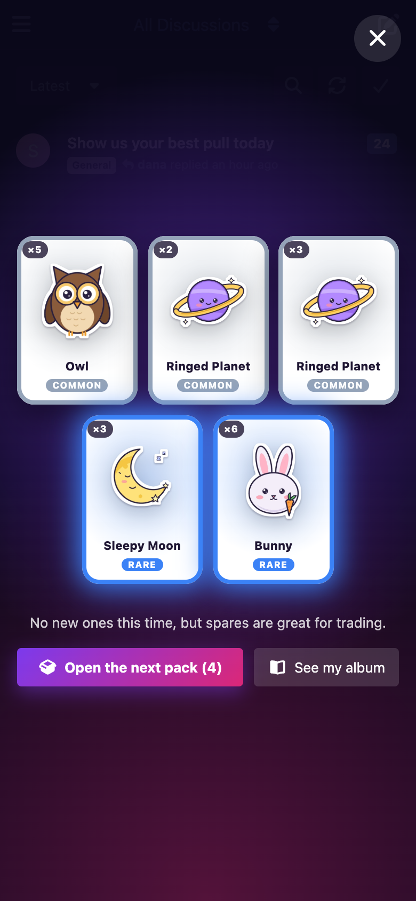

# Sticker Book

Members collect stickers in an album, a free pack every day, in your Flarum 2 community.

 [](https://packagist.org/packages/ernestdefoe/sticker-book)



- **A free pack every day.** Members open it with a reveal: the pack shakes and tears open, the stickers land face down and flip when tapped. Rare ones glow through their backs, epics and legendaries shine, a legendary sets off confetti.
- **Extra packs for taking part.** The first post of the day and every few likes received earn a pack, within a daily cap you choose. Each member's like on a post counts once, so liking and unliking again earns nothing.
- **Four rarities.** Common, rare, epic and legendary, with odds you set. A pity timer makes a legendary certain after so many packs without one, and every pack can promise at least one rare.
- **The album.** Every set with its progress, the stickers a member has (with ×N for spares) and silhouettes of the ones they're missing. Filters for missing stickers and spares.
- **Set badges.** Completing a set is recorded, and with FoF Badges it awards the badge you pick for that set.
- **Trading.** Offer your spares to another member, optionally asking for some of theirs; they accept or decline, and both hear about it. "Find someone with a spare" lists the members who have one of a sticker you're missing. Your album always keeps one of each. New accounts can trade once they are a week old (you choose how long).
- **Show off.** A member's rarest stickers on their profile card, a Stickers tab with their album, and a Top collectors board.
- **Stickers on posts.** Put one sticker from your own album on any post.
- **Starter sets.** Four sets of eight original stickers (woodland friends, space, snacks, forum life) to add with one click, or build your own: upload PNG or WebP art and pick a rarity.
- **Give packs** to a member for a contest or an event.
- **Notifications**, **permissions** (view albums, collect, trade, put stickers on posts) and **GDPR** export and erasure with Flarum's GDPR extension.

### Fair and safe by design

- What comes out of a pack is decided on the server with the system's cryptographic random generator. The browser only asks to open a pack.
- An album sends the art only for stickers the member has; missing stickers arrive as silhouettes stored under unrelated file names.
- Trades hold nothing while they wait. Accepting one runs in a single transaction that locks both members, takes each spare with a guarded update that can never go below one copy, and rolls everything back if a side no longer has the spares. A trade is accepted once, packs open once and the daily pack is claimed once, however fast the taps.
- Uploaded art is re-encoded as WebP (SVG is never accepted).

## Screenshots

| The album (dark) | Trading spares | On a phone |
| --- | --- | --- |
|  |  |  |

## Install

```sh
composer require ernestdefoe/sticker-book
```

Then open the extension's settings and click **Add the starter sets** (they arrive hidden: show them when you're ready), or run `php flarum sticker-book:starter`.

## Update

```sh
composer update ernestdefoe/sticker-book
php flarum migrate
php flarum cache:clear
```

## Links

- [Packagist](https://packagist.org/packages/ernestdefoe/sticker-book)
- [GitHub](https://github.com/ernestdefoe/sticker-book)
